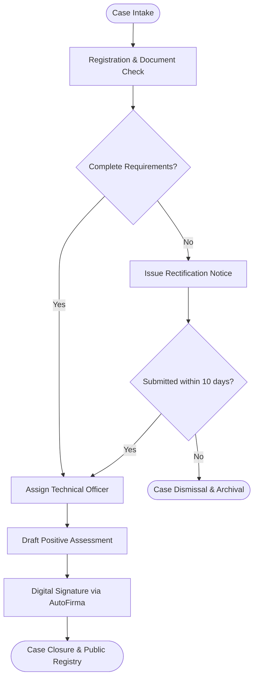
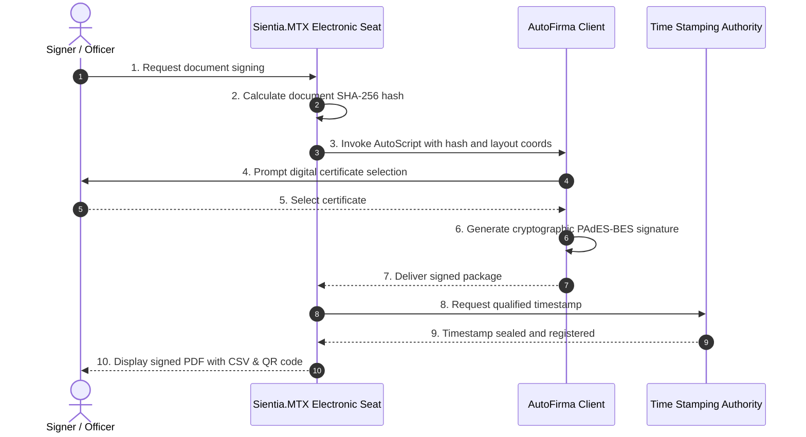
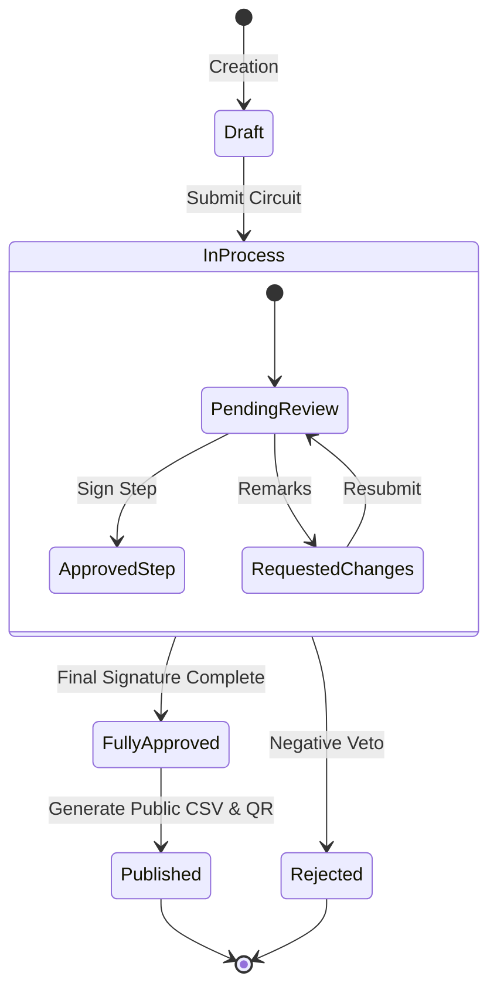
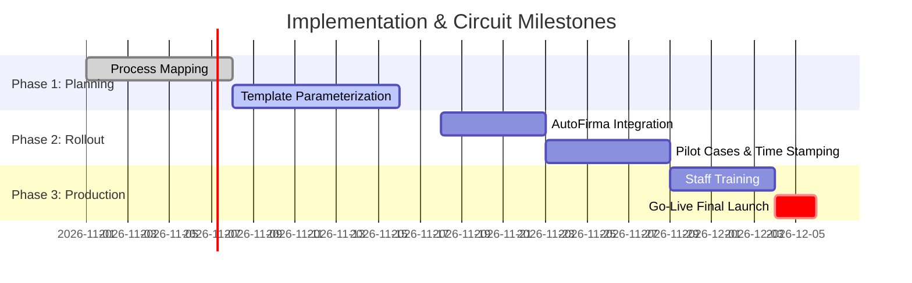
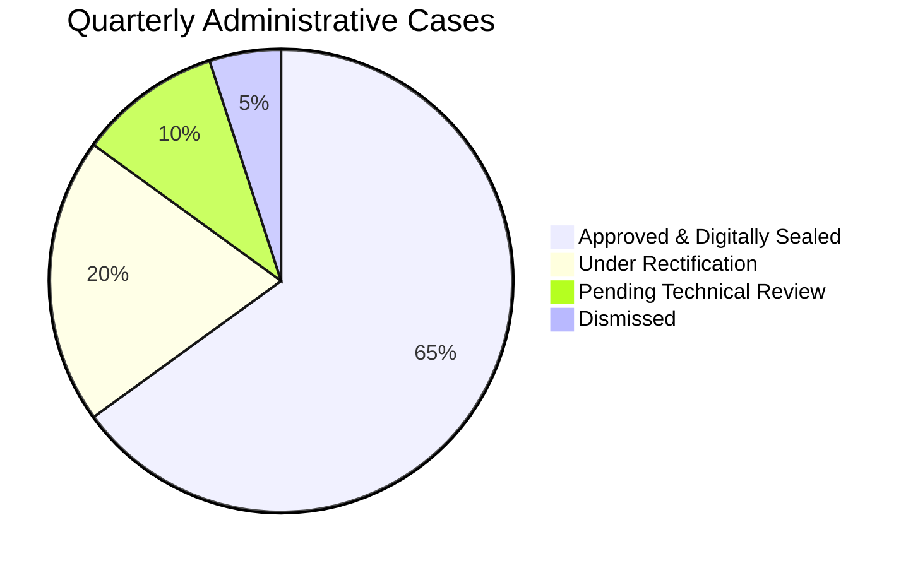

# Comprehensive Guide to Markdown & Mermaid Diagrams in Sientia.MTX

Sientia.MTX includes a rich drafting engine based on **Standard Markdown** and native support for **interactive vector diagrams with Mermaid**. This enables teams to organize proposals, tasks, administrative cases, and digital signature circuits with visual elegance, structure, and clarity, both in the web interface and in official PDF exports.

---

## 1. Markdown Essentials

Markdown is a lightweight markup language that applies formatting using plain text characters.

### 1.1 Headers
```markdown
# Level 1 Heading (Main Title)
## Level 2 Heading (Section)
### Level 3 Heading (Subsection)
#### Level 4 Heading (Sub-item)
```

### 1.2 Text Formatting
* **Bold**: `**bold text**`
* *Italic*: `*italic text*`
* ~~Strikethrough~~: `~~strikethrough text~~`
* Inline Code: `` `identifier_or_command` ``

### 1.3 Lists & Checklists
```markdown
* Standard bullet item
  * Sub-bullet item
* Another item

1. First operational step
2. Second review step
3. Final decision

- [x] Identity verification completed
- [x] Digital certificate validated
- [ ] Technical approval report
```

### 1.4 Tables
```markdown
| Phase | Assigned Officer | SLA / Deadline | Status |
| :--- | :--- | :---: | :--- |
| Intake | Citizen Service Center | 24 hours | Completed |
| Review | Case Manager | 10 days | In Progress |
| Resolution | Department Director | 5 days | Pending |
```

---

## 2. Mermaid Visual Diagrams

Mermaid compiles plain text descriptions into vector graphics (SVG). Enclose any diagram inside ```` ```mermaid ```` code fences to render it in Sientia.MTX.

### 2.1 Flowcharts & Decision Trees (`graph` / `flowchart`)


---

### 2.2 Sequence Diagrams (`sequenceDiagram`)


---

### 2.3 State Diagrams (`stateDiagram-v2`)


---

### 2.4 Gantt Charts (`gantt`)


---

### 2.5 Distribution Pie Charts (`pie`)


---

## 3. Editor Features in Sientia.MTX

1. **Toolbar Shortcut**: Click the **`MERMAID`** button next to the **`MARKDOWN`** cheat sheet in the editor.
2. **One-Click Insert**: Explore ready-to-use templates and click **`⚡ Insert into Document`** to drop code directly at the cursor position.
3. **Live Preview**: Switch to the **Preview** tab to review rendered diagrams before saving.
4. **PDF Output**: Sientia.MTX automatically renders and embeds clean, high-resolution diagram graphics in official PDF reports and signed circuit documents.
