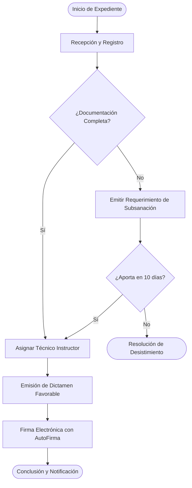
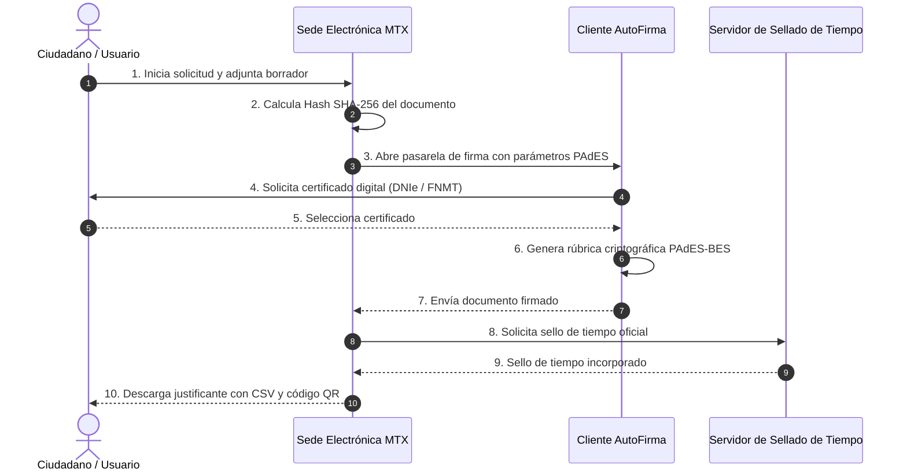
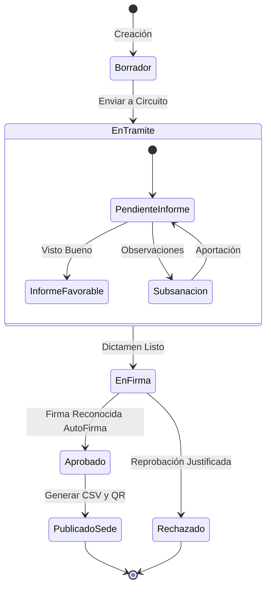
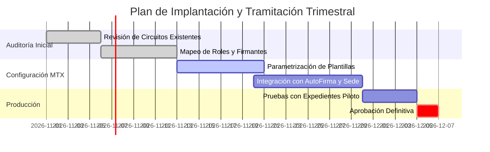
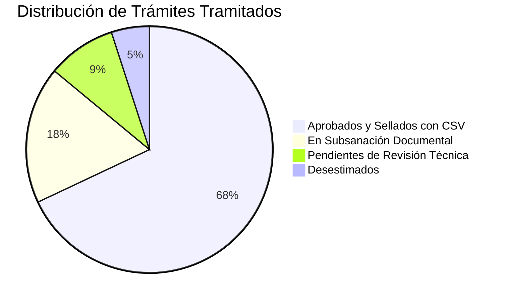
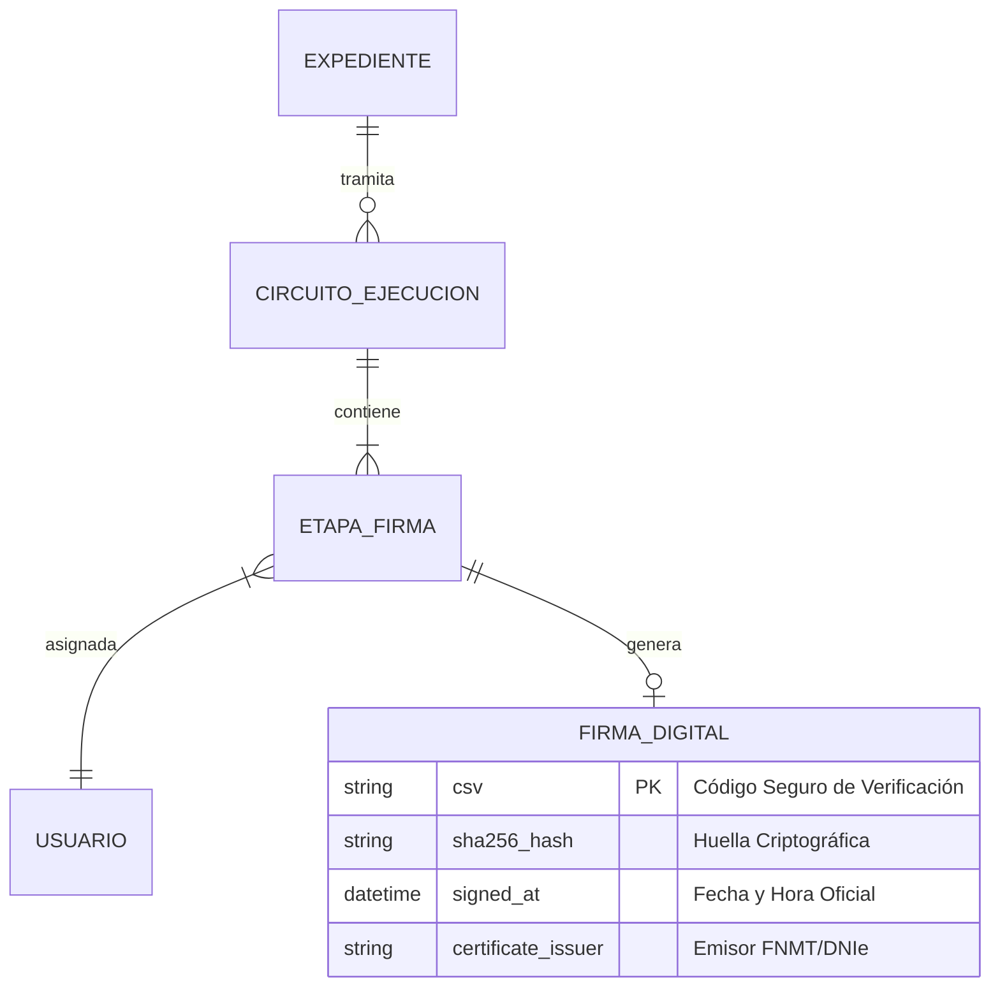

# Guía Completa de Markdown y Diagramas Mermaid en Sientia.MTX

Sientia.MTX incorpora un potente motor de redacción enriquecida basado en **Markdown estándar** y soporte nativo para **diagramas vectoriales interactivos con Mermaid**. Esta combinación permite estructurar propuestas, tareas, notas y circuitos administrativos con rigor visual, claridad y profesionalidad, tanto en el visor web como en los documentos PDF oficiales con validez jurídica.

---

## 1. Fundamentos de Markdown

Markdown es un lenguaje de marcado ligero que permite aplicar formato a un texto mediante caracteres sencillos sin necesidad de usar editores complejos.

### 1.1 Jerarquía de Títulos
Utiliza el carácter almohadilla (`#`) seguido de un espacio:

```markdown
# Título Principal (H1)
## Sección o Capítulo (H2)
### Subsección Temática (H3)
#### Apartado Detallado (H4)
```

### 1.2 Formato de Texto
* **Negrita**: `**texto destacado**` o `__texto destacado__`
* *Cursiva*: `*texto en cursiva*` o `_texto en cursiva_`
* ~~Tachado~~: `~~texto descartado~~`
* Código en línea: `` `código o identificador` ``

### 1.3 Listas y Tareas
Listas no ordenadas y listas numeradas:
```markdown
* Elemento de lista
  * Subelemento anidado
* Segundo elemento

1. Primer paso del procedimiento
2. Segundo paso de revisión
3. Resolución final
```

Listas de tareas con casillas de verificación (Checklists):
```markdown
- [x] Documentación de identidad aportada
- [x] Solicitud firmada digitalmente
- [ ] Informe técnico favorable
```

### 1.4 Tablas Estructuradas
```markdown
| Fase | Responsable | Plazo Máximo | Estado |
| :--- | :--- | :---: | :--- |
| Registro | Oficina de Atención | 24 horas | Concluido |
| Instrucción | Técnico Asignado | 10 días | En curso |
| Resolución | Dirección | 5 días | Pendiente |
```

### 1.5 Citas y Bloques de Código
```markdown
> **Nota legal**: Según el art. 26 de la Ley 39/2015, se consideran válidos los documentos electrónicos emitidos conforme al ENS.

```sql
SELECT id, title, status FROM circuit_executions WHERE team_id = 1;
```
```

---

## 2. Diagramas Visuales con Mermaid

Mermaid es una herramienta que genera diagramas y visualizaciones a partir de texto estructurado. En Sientia.MTX, cualquier bloque delimitado por ```` ```mermaid ```` se compila automáticamente en un **gráfico vectorial nítido (SVG)** en pantalla y se incrusta optimizado en las exportaciones PDF.

### 2.1 Flujogramas y Árboles de Decisión (`graph` / `flowchart`)
Ideal para reflejar rutas de aprobación, tomas de decisión y flujos de trabajo.

* Direcciones disponibles: `TD` (de arriba a abajo), `LR` (de izquierda a derecha), `BT` (de abajo a arriba).



#### Sintaxis de formas y nodos:
* Rectángulo: `[Texto]`
* Esquinas redondeadas: `(Texto)`
* Estadio / Píldora: `([Texto])`
* Rombo de decisión: `{¿Condición?}`
* Círculo: `((Texto))`

---

### 2.2 Diagramas de Secuencia (`sequenceDiagram`)
Muestra la comunicación temporal y los mensajes intercambiados entre diferentes usuarios, departamentos o servicios informáticos.



---

### 2.3 Máquinas y Ciclos de Estados (`stateDiagram-v2`)
Permite modelar con precisión los estados posibles de un expediente, tarea o circuito administrativo.



---

### 2.4 Cronogramas y Planificación (`gantt`)
Permite visualizar la planificación temporal de proyectos, convocatorias o fases de despliegue.



---

### 2.5 Gráficos Circulares de Reparto (`pie`)
Permite ilustrar cuotas de participación, porcentajes o estados de expedientes de forma gráfica y limpia en informes o propuestas.



---

### 2.6 Diagramas de Entidad-Relación (`erDiagram`)
Útil para documentar la arquitectura de datos entre expedientes, actividades, circuitos y firmas.



---

## 3. Integración en el Editor de Sientia.MTX

Para facilitar la redacción sin tener que memorizar la sintaxis:

1. **Botón Mermaid en el Editor**: En la barra superior de cualquier campo de texto con soporte Markdown, encontrarás el botón **`MERMAID`** al lado del botón de **`MARKDOWN`**.
2. **Chuleta Interactiva con Inserción Directa**: Al pulsar el botón se abrirá una ventana emergente organizada por categorías con plantillas listas. Basta con pulsar **`⚡ Insertar en Documento`** para colocar el código del diagrama en la posición exacta del cursor.
3. **Pestaña "Vista Previa"**: Cambia a la pestaña de vista previa del editor para comprobar cómo se dibuja tu diagrama antes de guardar la nota, actividad o circuito.
4. **Fidelidad en PDF**: Al exportar o firmar documentos oficiales, Sientia.MTX compila los diagramas en gráficos de alta definición que se incorporan simétricamente en el documento original.

